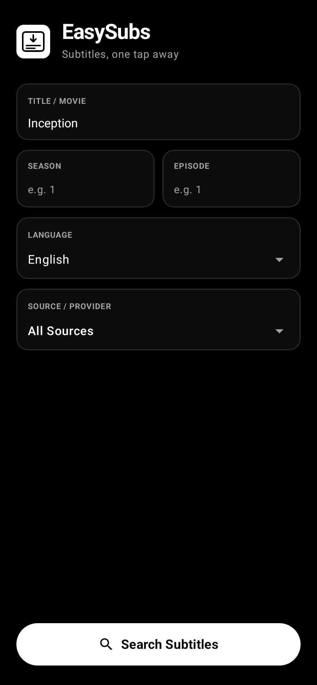
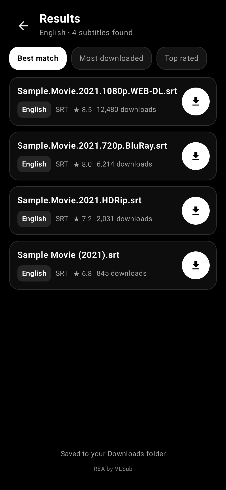

# EasySubs 🎬
> **Subtitles, one tap away.**  
> A fast, modern, and privacy-focused subtitle downloader and auto-translator for Android and Windows PC.

---

[](#android-app)
[](#desktop-app)
[](https://kotlinlang.org/)
[](https://developer.android.com/jetpack/compose)
[](https://www.python.org/)
[](https://unlicense.org/)

---

## 📱 Screenshots

| Search Screen | Results Screen |
| :---: | :---: |
|  |  |

---

## ✨ Features

- **🌐 Multi-Source Subtitle Search**:
  - **All Sources** (Unified search across all supported platforms simultaneously)
  - **SubtitleCat** (Includes on-the-fly automated translations)
  - **OpenSubtitles** (Direct high-speed XML-RPC integration)
  - **SubDL** & **Subscene** provider compatibility

- **⚡ Automated Subtitle Translation**:
  - Automatically translates subtitles line-by-line into **Bengali**, **Hindi**, **Spanish**, **French**, **German**, **Arabic**, **Japanese**, **Korean**, and 100+ other languages.
  - Keeps exact `.srt` timestamps, cue numbers, and italic/bold formatting intact.

- **🎯 Smart Name & Episode Detection**:
  - Paste any video or torrent file name (e.g. `Outer.Banks.S04E01.1080p.NF.WEBRip...`) and EasySubs automatically extracts the show title, season, and episode.
  - Automatic spelling correction and title suggestion fallback.

- **🖤 AMOLED Pure Black Theme**:
  - Sleek, battery-friendly `#000000` AMOLED dark mode.
  - Clean, compact input cards with dedicated number keyboards for Season & Episode.
  - Non-overlapping badge indicators (`[SubtitleCat]`, `[⚡ Bengali]`, `SRT`, `★ 9.0`).

- **📁 Instant Android MediaStore Integration**:
  - Automatically saves subtitles to `/storage/emulated/0/Download/` and `/storage/emulated/0/Movies/`.
  - Triggers Android's `MediaScannerConnection` so downloaded subtitles appear instantly in Samsung **My Files > Downloads** and third-party media players (VLC, MX Player, Nova).

- **💻 Desktop Companion App (Windows)**:
  - Matching AMOLED black theme Python / Tkinter desktop app (`VLSub_App.py`).
  - Standalone `.exe` single-file executable for one-click launching from Desktop.

---

## 📂 Repository Structure

```
EasySubs/
├── EasySubsAndroid/          # Native Android app source code
│   ├── app/
│   │   ├── src/main/
│   │   │   ├── kotlin/com/example/easysubs/
│   │   │   │   ├── network/      # OpenSubtitles XML-RPC, SubtitleCat, Translator
│   │   │   │   ├── ui/main/      # Jetpack Compose Search & Results UI
│   │   │   │   └── ui/theme/     # AMOLED pure black theme
│   │   │   ├── res/              # Vector drawables, launcher icons, layouts
│   │   │   └── AndroidManifest.xml
│   │   └── build.gradle.kts
│   ├── gradle/
│   ├── gradlew
│   └── settings.gradle.kts
├── VLSub_App.py              # Windows PC desktop subtitle downloader
├── Run_EasySubs.bat          # Batch launcher for desktop app
├── easysubs_icon.ico         # App Windows icon
├── white_logo_transparent.png# Header logo
├── screenshots/              # UI preview screenshots
├── LICENSE                   # Public domain (The Unlicense)
└── README.md
```

---

## 🚀 Getting Started

### Android App

#### Prerequisites:
- Android SDK (API 26+)
- JDK 17 or JDK 21

#### Build APK:
```bash
cd EasySubsAndroid
./gradlew assembleDebug
```
The compiled APK will be at:
`EasySubsAndroid/app/build/outputs/apk/debug/app-debug.apk`

#### Install on connected device:
```bash
adb install -r app/build/outputs/apk/debug/app-debug.apk
```

---

### Windows Desktop App

#### Requirements:
- Python 3.10+
- `Pillow` (for icon and logo rendering):
  ```bash
  pip install pillow
  ```

#### Run:
```bash
python VLSub_App.py
```
Or double click `Run_EasySubs.bat`.

---

## 🛠️ Tech Stack

- **Android**:
  - Jetpack Compose & Material 3
  - Kotlin Coroutines & Asynchronous Flow
  - Android MediaStore API & MediaScanner
  - Navigation 3 Runtime
- **Networking**:
  - XML-RPC (`api.opensubtitles.org`)
  - SubtitleCat REST scraper
  - Google Translate REST API
- **Desktop**:
  - Python 3
  - Tkinter & TTK custom dark theme
  - PyInstaller

---

## 📄 License

This project is released into the public domain under the [Unlicense](LICENSE). You are free to copy, modify, distribute, and use it for any purpose.
